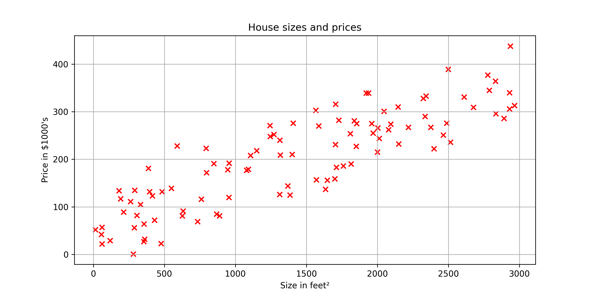
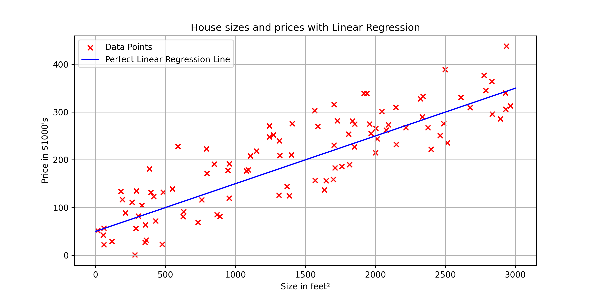
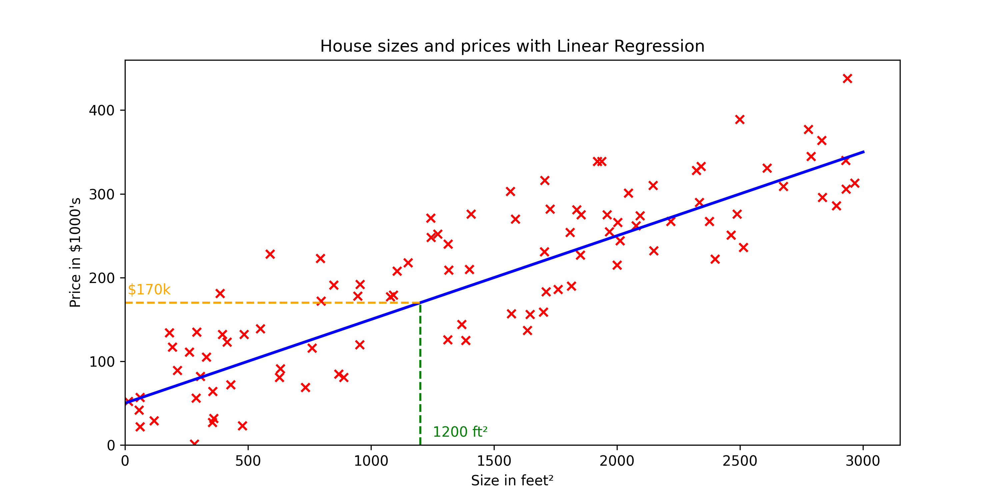
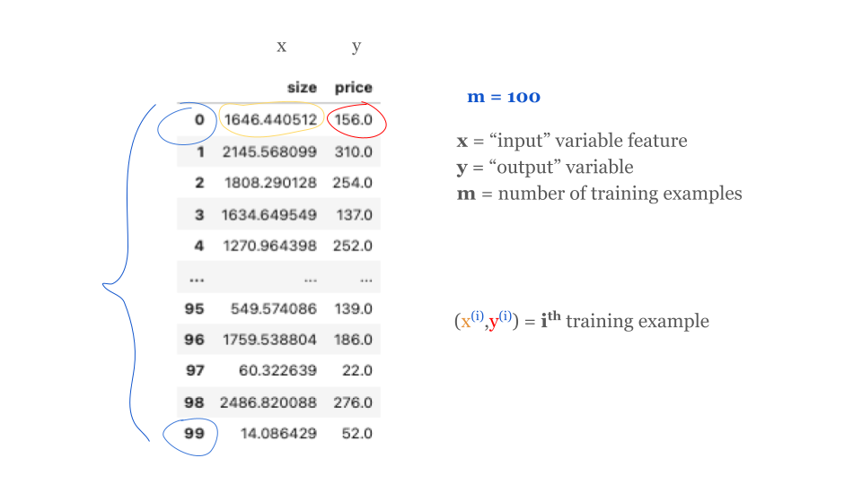
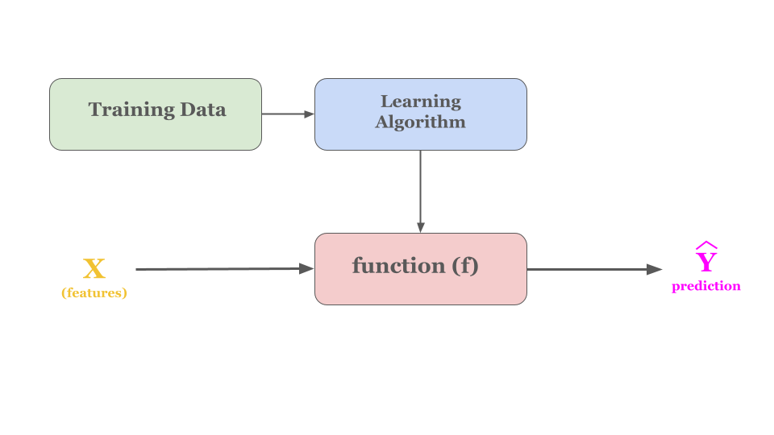
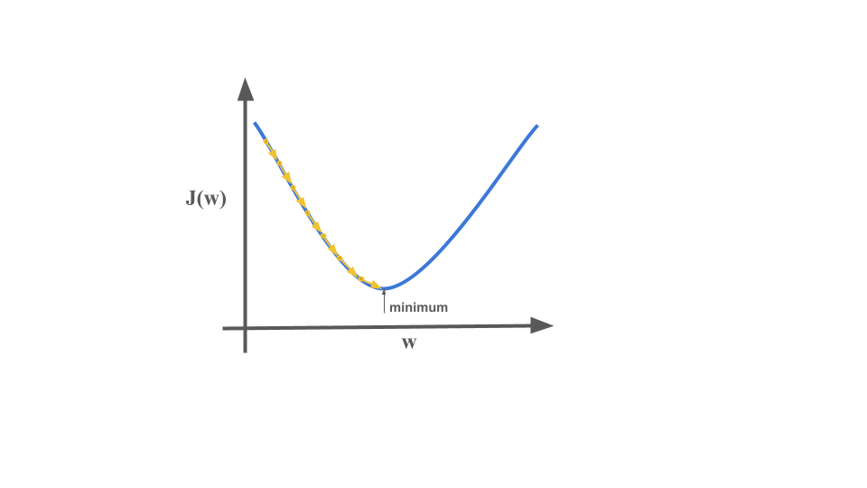

## Introduction
**Machine learning** : Learn from data and improve decision-making over time without human interference.

## Types of Learning In Machine Learning
There are two different types of learning's in machine learning.

- **Supervised :** Learn from the labeled data. 
- **Unsupervised :** Learn from the unlabeled data.

In this blog, You will understand about **Supervised Learning.**

There are two sub-categories in the Supervised Learning: 

- Regression
- Classification

**Regression :** That is used to predict continuous values, such as house prices, stock prices. 

To better understand, one might try out the house price prediction and linear regression model.

## Understanding Linear Regression
**Linear Regression Model :** Fitting straight line to the data.

Let's start with a problem that you can address using linear regression. Say you want to predict the price of a house based on the size of the house. 

Here we have a graph where the horizontal axis is the size of the house in square feet, and the vertical axis is the price of a house in thousands of dollars. 

Now, Let's say you are real estate agent, and you're helping a client to sell her house.  She is asking you, how much do you think I can get for this house? This dataset might help you estimate the price she could get for it by the help of linear regression model from this dataset.

Your model will fit a straight line to the data, which might look like this. 

Based on this straight line fit to the data, 

you can see that the house is 1200 square feet, it will intersect the best fit line over here, and if you trace that to the vertical axis on the left, you can see the price is maybe around here, say about $170,000.

This is an example of what's called a supervised learning model. We call this supervised learning because you are first training a model by giving a data that has right answers because you get the model examples of houses with both the size of the house, as well as the price that the model should predict for each house.

Here's a corrected version of the quoted sentence:

"When the linear line does not fit correctly, it can lead to increases and decreases in the predicted prices."

Now we have understood, what a traning dataset is like.  Let look at the process of how supervised learning works.

## Process of How Supervised Learning Works

How to represent **f**?

 
The model for linear regression is given by the equation:

$$f(x) = wx + b$$

In the equation $$f(x) = wx + b$$, think of $$x$$ as your input. The function transforms this input using fixed values for $$w$$ and $$b$$ to produce the output, $$\hat{y}$$, which is your estimated result.

In this equation, all you need to do is find the right $$w$$ and $$b$$ that make $$\hat{y}$$ predict correctly for your dataset.

We can try to find the right $$w$$ and $$b$$ with help of cost function. 

Explore how adjustments to the weights ($$w$$) and bias ($$b$$) affect the predictions by using the interactive linear regression model below.

## Interactive Linear Regression
<iframe src="/embeds/Interactive_Linear_Regression.html" title="Interactive linear regression (Plotly)" loading="lazy" height="640"></iframe>

## Cost Function
**Cost function** will tell us how well the model is doing so that we can try to get it to do better.

let's first take a look at how to measure how well a line fits the training data. To do that, we're going to construct a cost function. The cost function takes the prediction $$\hat{y}$$ and compares it to the target $$y$$ by taking $$\hat{y}$$ minus $$y$$. 

$$
\begin{equation}
\text{Error} = (\hat{y} - y)
\end{equation}
$$

This difference is called the error, we're measuring how far off to prediction is from the target. Next, let's computes the square of this error. Also, we're going to want to compute this term for different training examples i in the training set.

When measuring the error, for example $$i$$, we'll compute this squared error term. Finally, we want to measure the error across the entire training set. In particular, let's sum up the squared errors like this. We'll sum from $$i$$ equals 1,2, 3 all the way up to $$m$$. Remember, $$m$$ is the number of training examples, which is 100 for this dataset.

To build a cost function that doesn't automatically get bigger as the training set size gets larger by convention, we will compute the average squared error instead of the total squared error and we do that by dividing by m or 2m like this, 

$$
J(w,b) = \frac{1}{m} \sum_{i=0}^{m-1} (f_{w,b}(x^{(i)}) - y^{(i)})^2 
$$

$$\text{or}$$

$$
J(w,b) = \frac{1}{2m} \sum_{i=0}^{m-1} (f_{w,b}(x^{(i)}) - y^{(i)})^2
$$

This is also squared error cost function.

In machine learning different people will use different cost functions for different applications, but the squared error cost function is the most commonly used for linear regression and for that matter,  all regression problems where seems to give good results for many applications.

The goal of the linear regression is to minimize the cost function $$J(w,b)$$ we do it with help of gradient descent algorithm.

$$[minimize \quad J(w, b)]$$

## Gradient Descent
Gradient descent is used all over the place in machine learning, not just for linear regression. Here's an overview of what we'll do with gradient descent. You have the cost function $$j$$ of $$w$$, $$b$$ that you want to minimize.

Algorithm: 
- Start with some $$w$$, $$b$$
- Keep changing $$w$$ and $$b$$ to reduce $$J(w,b)$$ 
- Untill we settle at or near minima.

## Gradient Descent Algorithm
*Gradient descent* was described as:

$$
\begin{align*}
\text{repeat until convergence:} \; \{ \newline
\; w &= w - \alpha \frac{\partial J(w,b)}{\partial w}  \; \newline
b &= b - \alpha \frac{\partial J(w,b)}{\partial b} \newline \}
\end{align*}
$$

where, parameters $$w$$, $$b$$ are updated simultaneously. The gradient is defined as:

$$
\begin{align}
\frac{\partial J(w,b)}{\partial w} &= \frac{1}{m} \sum_{i = 0}^{m-1} (f_{w,b}(x^{(i)}) - y^{(i)})x^{(i)} \\
\frac{\partial J(w,b)}{\partial b} &= \frac{1}{m} \sum_{i = 0}^{m-1} (f_{w,b}(x^{(i)}) - y^{(i)}) \\
\end{align}
$$

Here *simultaneously* means that you calculate the partial derivatives for all the parameters before updating any of the parameters.

"Don't worry about those equations; they're just math puzzles. Once you figure them out, you'll find they're simpler than tying your shoes!"

## Implementation
Let's build a linear regression model from scratch. You can follow along in the notebook linked below:

<iframe src="/embeds/linear_regression.html" title="Linear regression notebook" loading="lazy" height="900"></iframe>

If you appreciate the content, Feel free to share the blogs.

## References
- **Supervised Learning:** Comprehensive details about supervised learning can be found in the Scikit-learn documentation. [Learn more about Supervised Learning.](https://scikit-learn.org/stable/supervised_learning.html)
- **Linear Model - Regression:** For an in-depth understanding of linear models in regression, refer to the Scikit-learn guide on linear regression. [Read about Linear Model-Regression.](https://scikit-learn.org/stable/modules/linear_model.html#regression)
- **Gradient Descent by Andrew Ng:** This video by Andrew Ng provides a foundational explanation of the gradient descent algorithm. [Watch the video on Gradient Descent.](https://www.youtube.com/watch?v=yFPLyDwVifc)
- **Machine Learning Specialization by Andrew Ng:** Explore the Machine Learning Specialization on Coursera to dive deeper into machine learning concepts taught by Andrew Ng. [Enroll in the Machine Learning Specialization.](https://www.coursera.org/specializations/machine-learning-introduction)
